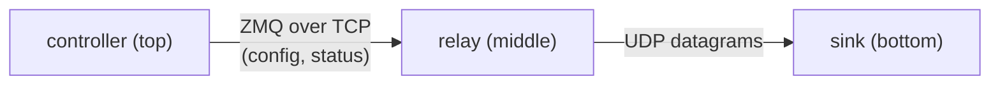

# qd-service-control: project outline

Status: draft input to the detailed design and plan. It sets out the problem,
the goals, the main concepts and the architectural direction. The detailed
design will settle the open questions at the end.

## 1. Problem

A stack of cooperating processes runs as systemd units on one host. The
processes talk to each other over TCP (often ZeroMQ) and UDP sockets. Starting
the stack takes tens of seconds: each unit has to start, bind its ports, and
connect to its peers. Only then is it safe to start the top-level service,
which pushes configuration down to the services below it.

Today this is handled by a mix of systemd ordering, fixed `sleep` delays and
shell helpers:

- systemd `After=` plus `ExecStartPost=qd-wait-for-port <port>` gates
  (`qd-rpm-build/scripts/qd-wait-for-port.sh`);
- fixed `ExecStartPre=/bin/sleep N` waits before the top-level services;
- `qd-check-connections`, a one-shot check of the live TCP edges against an
  expected map;
- `odinprocservcontrol`, an EPICS soft IOC that presses procServControl
  START/STOP buttons in a fixed order with fixed delays.

The end user can't see this process. They don't read a dozen journals while
the stack starts. When something doesn't come up, it's hard to tell which
service, or which pair of services, is at fault and which log to read.

## 2. Goals

`qd-service-control` must let the end user:

1. **See startup progress.** Watch units start, ports start listening and
   connections get made, as it happens, from one place and without reading
   logs.
2. **Gate the top-level service.** Make sure every sub-service is up, ready
   and listening, and every required connection is made, *before* the
   top-level service starts and pushes configuration down. The gate is an
   actual condition, not a fixed delay.
3. **Diagnose faults quickly.** When something isn't working, name the
   service or the service pair (edge) at fault, say which side is the likely
   cause, and point to the journal to read (unit and time window).

It also has to keep doing goals 1 and 3 after startup, so the user can see
when a running service or connection drops.

## 3. Scope

### In scope

- A **generic core**: a model of systemd services, the ports they listen on
  and the connections between them, driven by a configuration file. The core
  knows nothing about Xspress, Odin or EPICS.
- **Observation**: unit state, listening sockets and live connections,
  mapped to units.
- **Orchestration**: start, stop and restart a graph of units in dependency
  order, waiting on readiness conditions rather than delays.
- **Front-ends** on top of the core: a CLI first, and an EPICS soft IOC
  adapter for the QD deployment (replacing `odinprocservcontrol` and
  `procServControl`).
- **A small test stack**: three well-understood Python services, used to
  develop and test the core (Section 7).

### Out of scope (for now)

- Running the full Xspress/Odin/EPICS stack during development. It is a later
  validation target only (Section 9).
- Multi-host stacks. The core assumes one host; remote peers (for example,
  detector cards) show up only as IP addresses.
- Replacing systemd's own supervision (restart policies, cgroups, journald).
- RPM packaging. That belongs in `qd-rpm-build`, and any change there is
  proposed first.

## 4. Concepts

The configuration describes a directed graph:

| Concept         | Meaning                                                                                                                                                                   |
| --------------- | ------------------------------------------------------------------------------------------------------------------------------------------------------------------------- |
| **Service**     | One systemd unit (including template instances such as `foo@1.service`). It has dependencies, readiness conditions and the listeners it owns.                            |
| **Listener**    | A socket a service is expected to own: protocol (`tcp`/`udp`), port, and optionally a bind address. TCP: in `LISTEN` state. UDP: bound.                                     |
| **Edge**        | An expected connection from a client service to a server's listener: `client -> server:port/proto`. Edges can be required or optional.                                 |
| **Dependency**  | "B needs A ready before B starts". Usually follows the edges, but is declared separately, since not every edge implies a startup order (ZMQ, for example, reconnects). |
| **Readiness**   | The conditions under which a service counts as ready: unit active, listeners present, required outgoing edges established, plus optional extra checks.                    |
| **Group**       | A named set of services that can be started, stopped or watched together, such as "the whole stack" or "data path, card 2".                                              |

Every element (service, listener, edge) has a state that changes over time,
for example `unknown → waiting → ready`, or `ready → degraded/failed`. Each
change is a timestamped **event**. The stream of events is what the front-ends
show, and what the orchestrator waits on.

The graph can be a chain or a hierarchy (a DAG). For the QD stack, the
configuration also has to describe **parameterised instances**: N frame
receiver/processor pairs, with ports computed from the instance number. It also
needs **conditional edges**, such as hardware edges that exist only when a
detector is attached.

## 5. Architecture

```
          configuration file (services, listeners, edges, dependencies, readiness)
                                   │
                                   ▼
┌───────────────────────────────── core ──────────────────────────────────┐
│                                                                         │
│  observers ──────────────▶ state model ──────▶ event stream ──┐         │
│   • systemd unit state       (graph + live      (timestamped  │         │
│     (D-Bus)                   state per          changes)     │         │
│   • sockets → units           element)                        │         │
│     (/proc or sock_diag,                                      │         │
│      cgroup mapping)                                          ▼         │
│   • extra readiness checks             orchestrator ◀── waits on state  │
│                                         (start/stop/restart in order,   │
│                                          via systemd D-Bus jobs)        │
│                                        diagnoser (fault → service/edge  │
│                                          → likely side → journal ref)   │
└─────────────────────────────────────────────────────────────────────────┘
          │                         │                           │
          ▼                         ▼                           ▼
     CLI: status / watch       readiness gate CLI          EPICS soft IOC adapter
     / start / stop / diagnose (for ExecStartPre= in        (PVs, replaces
                                the top-level unit)          odinprocservcontrol)
```

Key points:

- **asyncio throughout**, matching `softioc`, `aioca` and `dbus-fast`.
  Python 3.11 on EL9 x86_64; developed on macOS.
- **systemd stays the process supervisor.** The tool starts and stops units
  through the systemd Manager D-Bus API and tracks each job. It never forks
  the services itself.
- **Observation is passive.** Sockets are inspected from the kernel's tables.
  The tool never connects to a port to probe it, so ZMQ and other protocols
  see no stray clients (the same principle as `qd-wait-for-port`).
- **Sockets are mapped to units by cgroup** (`/proc/<pid>/cgroup`), the same
  as `qd-check-connections`. A remote peer is shown by its IP address.
- **Diagnosis is a reading of the state model**, not a separate check. The
  rules include:
  - Unit not active: look at that unit.
  - Unit active but a listener is missing: look at the server side.
  - Listener present but an edge is missing: look at the client side, or its
    configuration.
  - Unit restarting repeatedly: look at its last exit status.

  Each finding names the unit or units and gives a `journalctl -u … --since …`
  reference.
- **The gate must not be bypassable by accident.** If the orchestrator alone
  enforces "sub-services ready before top-level", then a plain
  `systemctl start top` skips it. So the same readiness check is available as
  a CLI (`… wait <service>`) to run as `ExecStartPre=` in the top-level unit,
  generalising `qd-wait-for-port` from "one port" to "this part of the graph
  is ready". The orchestrator and the gate share one implementation.
- **Front-ends only consume the core.** The core has no EPICS dependency. The
  IOC adapter maps services, edges and events to PVs, and START/STOP/RESTART
  PVs to orchestrator calls.

## 6. User-facing behaviour (indicative)

- `status`: one table of services, listeners and edges, with their states.
- `watch`: a live view that streams events as the stack starts, for example
  "relay.service active (1.2 s)", "relay :5555/tcp listening (2.0 s)",
  "controller → relay:5555/tcp established (3.4 s)".
- `start|stop|restart <service|group>`: an ordered operation with progress.
  It finishes with success, or with a diagnosis naming what failed.
- `wait <service|group> [--timeout]`: blocks until ready. Exits non-zero with
  a diagnosis on timeout. Used as a systemd gate.
- `diagnose`: the current faults, each with its likely side and journal
  reference.
- The EPICS adapter exposes the same information: per-service and per-edge
  state, an overall "stack ready" PV, a recent-events/message PV, and control
  PVs.

## 7. Development test stack

Development and most testing use a small stack of three Python services that
we write ourselves. It exercises the same situations as the QD stack: a ZMQ
control link, a UDP data link, startup in dependency order, and a top-level
service that pushes configuration down.



Start order is **sink → relay → controller**. Stop order is the reverse.

| Service        | Role                                                                                                                                                         | Listens on                  | Ready when                                                         |
| -------------- | ------------------------------------------------------------------------------------------------------------------------------------------------------------ | --------------------------- | ------------------------------------------------------------------ |
| **sink**       | Lowest level. Receives datagrams and counts them, checking sequence numbers for gaps.                                                                        | UDP port (bound)            | Unit active and UDP port bound.                                    |
| **relay**      | Middle. Serves a ZMQ control socket. Once configured, sends datagrams to sink.                                                                               | ZMQ TCP port (`LISTEN`)     | Unit active, ZMQ port listening, UDP sender socket to sink exists. |
| **controller** | Top level. Connects to relay over ZMQ, pushes a configuration and checks the reply, then polls status. Stands in for the IOC that reconfigures odin-control. | none (client only)          | Unit active, edge to relay established, configuration acknowledged. |

The UDP direction (relay sends, sink receives) is an assumption to confirm. It
mirrors control flowing down and data flowing to the data-path service.

The test services must have:

- **Clear, structured logging to stdout/journald**: every state transition
  (binding, bound, connecting, connected, configured, first datagram, gap
  detected, shutdown), with consistent fields so log lines can be matched to
  events from the tool.
- **Configurable timing**, such as a delay before binding or before
  connecting, so startup progress is slow enough to watch and the gating
  logic is really exercised.
- **Fault injection** (by option or environment variable), so every
  diagnosis path can be reproduced on demand:
  - fail to bind, or bind the wrong port;
  - exit or crash after N seconds;
  - never connect, or connect to the wrong port;
  - stop sending datagrams;
  - become ready slowly, beyond the timeout;
  - ignore the configuration push;
  - spin at 100% CPU.
- **systemd units** with names outside `qd-*` (for example, `scdemo-*`), so
  they never clash with the QD helpers that act on every `qd-*` unit.
  Initially they are `Type=simple`, with no `sleep` gates, so the tool does
  the gating.
- **A configuration file for the tool describing this stack**: the first,
  and reference, example of the configuration format.

## 8. Testing approach

- **Unit tests on macOS**: config parsing, graph and ordering, state
  transitions, diagnosis rules. They run against fake observers and a fake
  systemd, so no Linux is needed.
- **Socket and cgroup parsing**: tests against captured `/proc` and `ss`
  fixtures from EL9.
- **Integration on Linux** with real systemd, D-Bus, polkit and journald:
  install the test stack and the tool, then run every startup and
  fault-injection scenario and check the reported events and diagnoses. The
  target is the shared test VM (`test-vm`, using dev unit names
  and a dev PV prefix), or a local systemd container (see open questions).

## 9. Applying it to the QD Xspress stack (later)

When the core works against the test stack, an Xspress configuration will
describe the real stack:

- FR/FP pairs per card, with computed ports;
- odin-control, meta-writer and live-view-merge;
- xspress-control, plus the hardware edges when a detector is attached;
- the IOC as the top-level service.

That configuration then replaces:

- the fixed `sleep` gates;
- the per-unit `qd-wait-for-port` gates (or wraps them);
- `qd-check-connections`, whose expected-edge list becomes the edges in the
  configuration;
- `odinprocservcontrol` and `procServControl`, through the EPICS adapter,
  keeping or improving on their PVs and EDM screens.

The packaging changes this needs in `qd-rpm-build` will be proposed
separately.

## 10. Open questions for the detailed design

1. **Who enforces the order: the tool, systemd, or both?** Options:
   - The tool drives each start and wait.
   - systemd ordering does it, with `wait` gates, and the tool only observes
     and reports.
   - A hybrid: gates in the units for safety, and the tool for orchestration
     and progress.

   The leaning is the hybrid, with one shared readiness check (Section 5).
2. **What counts as a UDP edge?** UDP has no connection state. If the sender
   calls `connect()`, its socket shows a peer address. If it doesn't, nothing
   links sender to receiver in the kernel tables. Per-socket traffic counters
   are limited (drops and queue lengths only). Options:
   - require senders to `connect()`;
   - accept "listener bound + sender socket exists" as the edge;
   - have services report traffic counters themselves (a convention the
     generic core can't rely on for third-party services).
3. **ZMQ semantics.** A ZMQ client can connect before the server binds, and
   it reconnects silently. A TCP connection being established shows the
   transport is up, not that the application handshake worked. Is
   transport-level enough, or do some edges need an application-level check
   (like the controller's "configuration acknowledged")?
4. **Extra readiness checks: which kinds, and how pluggable?** Candidates:
   - a file exists (such as the FR shared-memory buffer);
   - `sd_notify` `READY=1` (`Type=notify`);
   - a command exits 0;
   - a journal line matches.
5. **Configuration format.** TOML (read with `tomllib` from the 3.11 standard
   library, no extra dependency) or YAML. How should instance templating and
   conditional edges be expressed?
6. **Socket inspection method and privileges.** The options are parsing
   `/proc/net/*` plus `/proc/<pid>/fd`, using netlink `sock_diag`, or shelling
   out to `ss -p`. Seeing other users' sockets needs root or
   `CAP_SYS_PTRACE`/`CAP_NET_ADMIN`. Unit control needs a polkit rule. Which
   user does the tool run as?
7. **Stop and restart semantics.** When a sub-service restarts, should its
   dependents be restarted too, or reconfigured (for example, the top level
   re-pushing configuration), or left to reconnect? Is that set per edge or
   per dependency in the configuration?
8. **Polling vs events.** Unit state is event-driven over D-Bus. Socket state
   is polled. What poll interval gives responsive progress at negligible CPU
   cost?
9. **Linux integration environment.** Is the shared VM enough, or do we also
   want a local EL9 container with systemd as PID 1 (Rancher Desktop) for
   faster iteration?
10. **Front-end priority.** Should the CLI's `watch` be plain streaming lines,
    a full-screen TUI, or both? When does the EPICS adapter come relative to
    the core?

## 11. Indicative phases

1. Test stack: the three services, their logging and fault injection, and
   their units.
2. Core model, configuration format and observers. CLI `status` and `watch`.
3. Orchestrator and readiness gate. CLI `start`/`stop`/`restart`/`wait`.
4. Diagnosis rules and journal references. CLI `diagnose`. Fault-injection
   integration tests.
5. EPICS soft IOC adapter.
6. Xspress configuration and validation on the test VM. Packaging proposal for
   `qd-rpm-build`.
