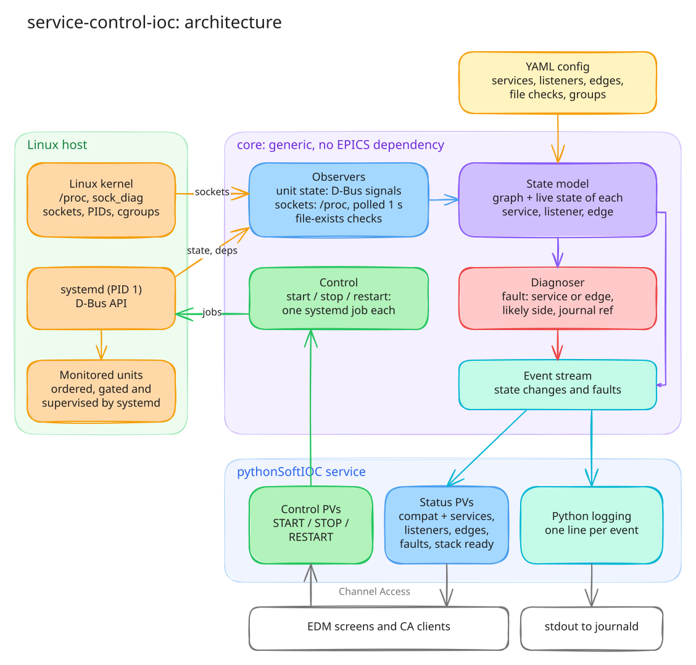
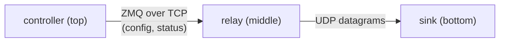

# service-control-ioc: project outline

Status: input to the detailed design and plan. It sets out the problem, the
goals, the main concepts and the architectural direction. Section 10 records
the decisions made so far and the items left for the detailed design.

## 1. Problem

A stack of cooperating processes runs as systemd units on one host. The
processes talk to each other over TCP (often ZeroMQ) and UDP sockets. Starting
the stack takes tens of seconds: each unit has to start, bind its ports, and
connect to its peers. Only then is it safe to start the top-level service,
which pushes configuration down to the services below it.

Today this is handled by a mix of systemd ordering, fixed `sleep` delays and
shell helpers:

- systemd `After=` plus `ExecStartPost=qd-wait-for-port <port>` gates
  (`qd-rpm-build/scripts/qd-wait-for-port.sh`);
- fixed `ExecStartPre=/bin/sleep N` waits before the top-level services;
- `qd-check-connections`, a one-shot check of the live TCP edges against an
  expected map;
- `odinprocservcontrol`, an EPICS soft IOC that presses procServControl
  START/STOP buttons in a fixed order with fixed delays.

The end user can't see this process. They don't read a dozen journals while
the stack starts. When something doesn't come up, it's hard to tell which
service, or which pair of services, is at fault and which log to read.

## 2. Goals

`service-control-ioc` must let the end user:

1. **See startup progress.** Watch units start, ports start listening and
   connections get made, as it happens, from one place (EPICS PVs and the
   service's log output) and without reading every journal.
2. **Make sure the top-level service is gated.** Every sub-service must be up,
   ready and listening, and every required connection made, *before* the
   top-level service starts and pushes configuration down. systemd enforces
   the order, using readiness gates in the units (Section 5). This tool shows
   that the order held, and reports clearly when it didn't (for example, the
   top level started while a dependency's listener was still missing).
3. **Diagnose faults quickly.** When something isn't working, name the
   service or the service pair (edge) at fault, say which side is the likely
   cause, and point to the journal to read (unit and time window).

It also has to keep doing goals 1 and 3 after startup, so the user can see
when a running service or connection drops.

## 3. Scope

### In scope

- A **generic core**: a model of systemd services, the ports they listen on
  and the connections between them. It is driven by a YAML configuration file
  plus the units' own systemd dependencies. The core knows nothing about
  Xspress, Odin or EPICS.
- **Observation**: unit state, listening sockets and live connections,
  mapped to units, and the events when any of them change.
- **Control**: start, stop and restart a unit or a group target, each as a
  single systemd job. systemd does the ordering.
- **One front-end: a long-running pythonSoftIOC service.** It publishes the
  model's state and controls as Channel Access PVs, and logs every event
  through Python `logging`. There is no interactive CLI. The terminal or
  journal shows the log output.
- **Strict PV compatibility** with `odinprocservcontrol` and the patched
  `procServControl`, with new PVs for services, listeners and edges added
  alongside the existing ones.
- **A small test stack**: three (or more) well-understood Python services and
  their units, used to develop the tool and to try out the gating patterns
  that the Xspress units use (Section 7).

### Out of scope (for now)

- Running the full Xspress/Odin/EPICS stack during development. It is a later
  validation target only (Section 9).
- Multi-host stacks. The core assumes one host; remote peers (for example,
  detector cards) show up only as IP addresses.
- Ordering or orchestrating starts itself. That's systemd's job, as are
  supervision, restart policies and propagation (`Restart=`, `PartOf=`,
  `BindsTo=`), cgroups and journald.
- Generating or installing unit files or drop-ins.
- RPM packaging. That belongs in `qd-rpm-build`, and any change there is
  proposed first.

## 4. Concepts

The model is a directed graph:

| Concept        | Meaning                                                                                                                                                                                                                   | Source                                    |
| -------------- | ------------------------------------------------------------------------------------------------------------------------------------------------------------------------------------------------------------------------- | ----------------------------------------- |
| **Service**    | One systemd unit (including template instances such as `foo@1.service`) that the tool monitors.                                                                                                                         | YAML config                               |
| **Dependency** | "B starts after A". Read from the units' `After=`/`Requires=`/`Wants=` over D-Bus. Never declared twice.                                                                                                                | systemd                                   |
| **Listener**   | A socket a service is expected to own: protocol (`tcp`/`udp`), port, and optionally a bind address. TCP: in `LISTEN` state. UDP: bound.                                                                                 | YAML config                               |
| **Edge**       | An expected connection from a client service to a server's listener: `client -> server:port/proto`. Edges can be required or optional. Edges are transport-level only: an edge is up when TCP is `ESTABLISHED`, and UDP edges are best effort (Section 5). | YAML config                               |
| **Readiness**  | When a service counts as ready: unit active (for `Type=notify` units this means it has sent `READY=1`), its listeners present, its required outgoing edges up, and any configured file-exists checks satisfied.        | YAML config + systemd                     |
| **Group**      | A named set of services that can be controlled or watched together, usually a systemd target such as `qd-xspress-all`.                                                                                                 | YAML config (often a target in systemd)   |

Every element (service, listener, edge) has a state that changes over time,
for example `unknown → waiting → ready`, or `ready → degraded/failed`. Each
change is a timestamped **event**. The stream of events is what gets logged
and published as PVs.

The graph can be a chain or a hierarchy (a DAG). For the QD stack, the
configuration also has to describe **parameterised instances**: N frame
receiver/processor pairs, with ports computed from the instance number. It also
needs **conditional edges**, such as hardware edges that exist only when a
detector is attached.

## 5. Architecture

The source is
[`images/architecture.excalidraw`](images/architecture.excalidraw). To edit
the diagram, open it in [Excalidraw](https://excalidraw.com), then re-export
the SVG with the font embedded.

Key points:

- **asyncio throughout**, matching `softioc`, `aioca` and `dbus-fast`.
  Python 3.11 on EL9 x86_64; developed on macOS.
- **systemd owns ordering and supervision.** The units' `After=` and
  readiness gates (`ExecStartPost=` wait helpers, or `Type=notify`) decide
  when a dependent may start. The tool reads those dependencies and observes
  the results. Its controls are single systemd jobs (start, stop, restart of a
  unit or group target). It never forks services or runs steps in its own
  order.
- **No subprocesses.** Everything is read in-process:
  - the systemd D-Bus API first, using subscriptions and `PropertiesChanged`
    signals wherever they fit;
  - then the `/proc` filesystem;
  - netlink `sock_diag` as the last resort.

  systemd's D-Bus API gives unit state, PIDs and dependencies. It doesn't say
  which ports a service unit listens on or what it's connected to, so
  listeners and edges are expected to come from `/proc`. The design settles
  each signal's mechanism.
- **Observation is passive.** Sockets are read from the kernel's tables. The
  tool never connects to a port to probe it, so ZMQ and other protocols see no
  stray clients (the same principle as `qd-wait-for-port`).
- **Sockets are mapped to units by cgroup**, the same as
  `qd-check-connections`. A remote peer is shown by its IP address.
- **Socket state is polled every 1 s.** Unit state is event-driven.
- **UDP edges are best effort.** An edge needs the receiver bound and the
  sender holding a UDP socket. If the sender `connect()`s, the edge is
  matched precisely by its peer address. Otherwise it is reported as "sender
  socket present". A traffic check is not part of the core.
- **The tool runs as the same user as the stack** (`xspress` for QD), so it
  can see the stack's processes and sockets without extra capabilities. A
  polkit rule, limited to the configured units, allows its systemd control
  jobs. Sockets owned by other users' processes can't be attributed to a
  unit and are reported as external.
- **Diagnosis is a reading of the state model**, not a separate check. The
  rules include:
  - Unit not active: look at that unit.
  - Unit active but a listener is missing: look at the server side.
  - Listener present but an edge is missing: look at the client side, or its
    configuration.
  - Unit restarting repeatedly: look at its last exit status.
  - A dependent became active before its dependency was ready: the gating
    is wrong.

  Each finding names the unit or units and gives a `journalctl -u … --since …`
  reference for the user to follow.
- **The IOC only consumes the core.** The core has no EPICS dependency. The
  IOC maps services, edges and events to PVs, and control PVs to core control
  calls.

## 6. User-facing behaviour (indicative)

- **Log output** (stdout, so it goes to the journal under systemd): one line
  per event, with consistent fields. For example:
  - `relay.service active (1.2 s)`
  - `relay :5555/tcp listening (2.0 s)`
  - `edge controller -> relay:5555/tcp established (3.4 s)`
  - `FAULT edge controller -> relay:5555/tcp missing: listener present, look at controller (journalctl -u controller --since 10:41:02)`
- **Compatibility PVs**: the existing `odinprocservcontrol` and
  `procServControl` PVs, with the same names and semantics, so the existing
  EDM screens and scripts keep working. Their START/STOP/RESTART map to
  systemd jobs.
- **New PVs** alongside them:
  - per service: unit state, ready flag, restart count;
  - per listener and per edge: state;
  - an overall "stack ready" PV;
  - current faults and a recent-events message PV.

## 7. Development test stack

Development and most testing use a small stack of Python services that we
write ourselves. It exercises the same situations as the QD stack:

- a ZMQ control link and a UDP data link;
- startup in dependency order;
- a top-level service that pushes configuration down;
- the same gating patterns the Xspress units use.

Start order is **sink → relay → controller**, set by `After=` in the units.
Stop order is the reverse.

| Service        | Role                                                                                                                                                         | Listens on              |
| -------------- | ------------------------------------------------------------------------------------------------------------------------------------------------------------ | ----------------------- |
| **sink**       | Lowest level. Receives datagrams and counts them, checking sequence numbers for gaps.                                                                        | UDP port (bound)        |
| **relay**      | Middle. Serves a ZMQ control socket. Once configured, sends datagrams to sink.                                                                               | ZMQ TCP port (`LISTEN`) |
| **controller** | Top level. Connects to relay over ZMQ, pushes a configuration and checks the reply, then polls status. Stands in for the IOC that reconfigures odin-control. | none (client only)      |

**Gating.** One purpose of the test stack is to try out and verify the gating
used in the Xspress units:

- at least one unit is gated by `ExecStartPost=` with `qd-wait-for-port` or
  a similar helper, so `After=` means "listening";
- at least one service is `Type=notify` and sends `READY=1` itself once it
  is ready.

More services can be added where a pattern needs one. For example, a
shared-memory producer/consumer pair would exercise the
`qd-wait-for-fr-buffer` file gate.

The test services must have:

- **Clear, structured logging to stdout/journald**: every state transition
  (binding, bound, connecting, connected, configured, first datagram, gap
  detected, shutdown), with consistent fields so log lines can be matched to
  the tool's events.
- **Configurable timing**, such as a delay before binding, before connecting,
  or before notifying ready, so startup progress is slow enough to watch and
  the gates are really exercised.
- **Fault injection** (by option or environment variable), so every
  diagnosis path can be reproduced on demand:
  - fail to bind, or bind the wrong port;
  - exit or crash after N seconds;
  - never connect, or connect to the wrong port;
  - stop sending datagrams;
  - become ready slowly, beyond the gate's timeout;
  - never send `READY=1`;
  - ignore the configuration push;
  - spin at 100% CPU.
- **systemd units** with names outside `qd-*` (for example, `scdemo-*`), so
  they never clash with the QD helpers that act on every `qd-*` unit. They
  run as a dedicated service user, and the tool runs as that user too.
- **A YAML configuration for the tool describing this stack**: the first,
  and reference, example of the configuration format.

## 8. Testing approach

- **Unit tests on macOS**: config parsing, graph building from (faked) unit
  dependencies, state transitions, diagnosis rules, PV mapping. They run
  against fake observers and a fake systemd, so no Linux is needed.
- **`/proc` and cgroup parsing**: tests against fixtures captured from EL9.
- **Local integration**: a Rocky 9 container with systemd as PID 1 under
  Rancher Desktop. It runs the test stack, its gates and the IOC, and goes
  through every startup and fault-injection scenario, checking the logged
  events, PVs and diagnoses. On this Mac the container is aarch64, which is
  fine for pure-Python code.
- **Target integration**: the shared VM `test-vm` (x86_64, with
  the real QD stack installed), using dev unit names and a dev PV prefix.

## 9. Applying it to the QD Xspress stack (later)

When the core works against the test stack, an Xspress configuration will
describe the real stack's listeners and edges:

- FR/FP pairs per card, with computed ports;
- odin-control, meta-writer and live-view-merge;
- xspress-control, plus the hardware edges when a detector is attached;
- the IOC as the top-level service.

The dependencies come from the installed units.

The IOC then:

- replaces `odinprocservcontrol` and `procServControl`, keeping their PVs
  (strict compatibility) so the existing EDM screens work;
- provides continuous monitoring in place of the one-shot
  `qd-check-connections`, whose expected-edge list becomes the edges in the
  configuration;
- reports on whether the units' gates hold.

What the test stack shows about gating (for example, whether some
`qd-wait-for-port` gates or `sleep` waits should become `Type=notify` or a
better helper) feeds into change proposals for the `qd-rpm-build` units.
Those proposals, and the packaging of this tool, are made separately.

## 10. Decisions and design-time items

### Decisions

| #   | Topic                       | Decision                                                                                                                                                                                                                                                           |
| --- | --------------------------- | ------------------------------------------------------------------------------------------------------------------------------------------------------------------------------------------------------------------------------------------------------------------ |
| D1  | Start ordering              | systemd enforces it (`After=` plus readiness gates in the units). The tool observes, reports and diagnoses, and doesn't orchestrate.                                                                                                                              |
| D2  | Dependency graph            | Read from systemd (`After=`/`Requires=`/`Wants=`) over D-Bus. The tool's configuration adds only listeners, edges, readiness checks and groups.                                                                                                                   |
| D3  | Controls                    | Start/stop/restart of a unit or group target, as a single systemd job each. Restart propagation is systemd's (`PartOf=`, `BindsTo=`, `Restart=`).                                                                                                                 |
| D4  | Configuration format        | YAML.                                                                                                                                                                                                                                                              |
| D5  | UDP edges                   | Socket-level, best effort: receiver bound and a sender socket present, matched by peer address when the sender `connect()`s.                                                                                                                                      |
| D6  | TCP/ZMQ edges               | Transport level only: up when `ESTABLISHED`. There are no application-level checks in the core.                                                                                                                                                                  |
| D7  | Extra readiness checks (v1) | File exists (optionally non-empty), and `Type=notify` `READY=1` (unit active). No command or journal-match checks.                                                                                                                                                 |
| D8  | Observation mechanisms      | No subprocesses. D-Bus (subscriptions/signals) first, then `/proc`, then netlink `sock_diag`. The design picks each signal's mechanism.                                                                                                                         |
| D9  | Socket polling              | Fixed 1 s interval. Unit state is event-driven.                                                                                                                                                                                                                  |
| D10 | Privileges                  | Runs as the same user as the stack (`xspress` for QD). A polkit rule allows its control jobs.                                                                                                                                                                   |
| D11 | Front-end                   | A pythonSoftIOC service publishing PVs over Channel Access, plus Python `logging` of every event. No interactive CLI.                                                                                                                                             |
| D12 | PV interface                | Strict compatibility with the `odinprocservcontrol` and `procServControl` PVs, with new PVs added alongside.                                                                                                                                                     |
| D13 | Test stack                  | sink ← relay ← controller. UDP flows relay → sink, ZMQ runs controller → relay. Gating uses `qd-wait-for-port`-style helpers and at least one `Type=notify` service. More services can be added when a pattern needs one.                                         |
| D14 | Integration environments    | A local Rocky 9 systemd container (Rancher Desktop) plus the shared VM `test-vm`.                                                                                                                                                                      |

### For the detailed design

1. **Mechanism for each signal** (D8): which systemd D-Bus properties and
   signals to use for unit state, `MainPID`/cgroup and dependencies, and how
   to read listeners and edges from `/proc`. When is `sock_diag` needed?
2. **Journal references without subprocesses.** Diagnosis gives a
   `journalctl` reference for the user. If the tool needs to read journal
   lines itself, how does it do that? EL9's `python3-systemd` targets Python
   3.9, not 3.11. Reading the journal as `xspress` also needs
   `systemd-journal` group membership.
3. **Compatibility PV inventory** (D12): the full list of
   `odinprocservcontrol` and patched `procServControl` PVs and their
   semantics. How do procServ-specific PVs (console, procServ status, auto
   restart) map onto systemd units? Which have no sensible equivalent?
4. **New PV layout**: naming for per-service, per-listener and per-edge PVs,
   and how a variable number of instances and edges maps to a fixed IOC
   record set.
5. **YAML schema**: services, listeners, edges, file checks and groups;
   instance templating (N cards, computed ports); conditional edges
   (hardware present); validation and error reporting.
6. **Which services are gated how in the test stack**: which units use
   `ExecStartPost=` wait helpers, and which uses `Type=notify`.
   `qd-wait-for-port` checks TCP only (`ss -ltn`), so how is a UDP listener
   (sink) gated? How do the helpers get into the local container (installed
   from the `qd-*` RPMs, or a dev copy)?
7. **Gate-violation detection**: how to tell reliably from events and
   timestamps that a dependent started before its dependency was ready.
8. **polkit rule** for the control jobs, scoped to the configured units, and
   where it's installed (test stack vs. QD packaging).
9. **systemd container setup** for local integration: base image, D-Bus,
   journald, and running the test units and the IOC inside it.

## 11. Indicative phases

1. Test stack: the three services, their logging and fault injection, their
   units and gates (wait helper and `Type=notify`), and the local systemd
   container.
2. Core model, YAML configuration, dependency reading from systemd, and
   observers. Event logging.
3. Diagnosis rules (including gate violations), journal references, and
   fault-injection integration tests.
4. The soft IOC: compatibility PVs, new PVs and controls.
5. Xspress configuration and validation on the test VM. Proposals for
   `qd-rpm-build` (gating changes, packaging).
